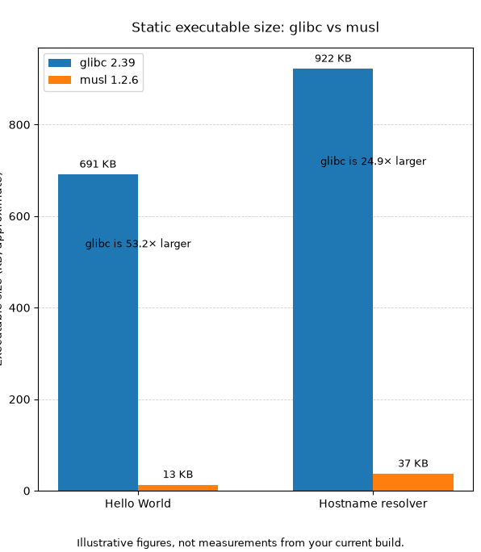

# Introduction

Every Void Linux download asks the same question before anything else: **glibc or musl?** The answer determines the C library that every program on the system will be linked against, and Void publishes separate package repositories for each choice.

This choice is effectively permanent. A system installed from a musl image updates from the musl repository, and a glibc system updates from the glibc repository. There is no supported conversion path because each installed binary is linked to one library or the other. Changing the C library means reinstalling the system.

This tutorial explains what a C library does, how glibc and musl differ in practice, which software is available for each on Void, and how to run glibc programs on a musl host when you have no alternative.

> **Source and testing note:** This article is based on a technical video transcript. Version numbers, measurements, package counts and package-availability figures are reported as stated in that source. The commands are documented for reference; they were not independently executed while preparing this article. Details that should be checked against current documentation are marked **Verify**.

> **Convention used in this article:** Statements without a label come from the source. Short **Background** notes add standard technical context. **Verify** notes identify details that may change over time or that the source did not state precisely.

# Prerequisites

- A Void Linux installation image or an installed Void system.
- A user account with `sudo` or root access for package management and chroot setup.
- Basic familiarity with a Linux terminal and package installation.
- Knowledge of your hardware, especially the graphics card.
- A list of the applications you need, particularly proprietary or gaming software.
- For the chroot method: the `xtools` package, which provides `xchroot`.
- Optional: Flatpak, if you want to run applications that ship their own runtime.

Before proceeding, confirm that you have not yet committed to an installation. If the system is already installed, changing the C library requires a reinstall. Keeping `/home` on a separate partition preserves personal files and many application settings across that reinstall.

# Understanding the concepts

## What a C library does

Ordinary programs do not make system calls to the Linux kernel directly. They call functions provided by the C library, and the C library performs the underlying system calls. Opening files, allocating memory, printing output, creating threads and resolving hostnames all go through it.

The C library also includes the **dynamic loader**, the component that starts dynamically linked executables, locates their shared libraries and links them before the program runs. Because nearly every program depends on this library, replacing it changes the foundation of the entire system rather than the behaviour of a single application.

## Why binaries do not cross between implementations

A dynamically linked executable records the path of the loader it expects.

- On x86-64, a program built against glibc expects `/lib64/ld-linux-x86-64.so.2`.
- A program built against musl expects `/lib/ld-musl-x86_64.so.1`.

If the expected loader is absent, the kernel cannot start the program. The shell may report `No such file or directory` even though the executable is present, which is a common source of confusion. Even when a compatible loader exists, the program also expects the specific symbols and behaviour of the library it was built against. That mismatch is the root of most compatibility problems discussed below.

**Background:** On musl, the C library and the dynamic loader are the same file. glibc keeps them as separate components.

## Identifying the C library of a system or program

The source demonstrates three commands for inspecting a Void system and its binaries:

```bash
xbps-uhelper arch
# x86_64        on a glibc system
# x86_64-musl   on a musl system

file /usr/bin/ls
# prints the executable format and, for dynamic binaries,
# the interpreter (loader) path

ldd /usr/bin/ls
# lists the shared libraries required by a dynamic executable
```

- `xbps-uhelper arch` prints the architecture string used by XBPS. The `-musl` suffix identifies a musl system.
- `file` reads the executable header and reports the interpreter path, which reveals the library the program was built for.
- `ldd` lists the shared-library dependencies of a dynamic program.

On musl, `ldd` reports the musl loader as the C library because both functions are combined in one file.

> **Security caution:** Do not run `ldd` on a program you do not trust. `ldd` can cause code from the program's loader to execute. `file` only reads the header and is the safer choice for unknown binaries.

## glibc

glibc is the GNU C Library, developed by the GNU Project since the late 1980s and licensed under the LGPL. It is the C library used by most mainstream Linux distributions, which is why commercial and proprietary software is commonly built and tested against it. Its design prioritises features and compatibility.

glibc implements the C and POSIX standards plus many GNU extensions. It preserves compatibility with older binaries through symbol versioning, supports pluggable name services through NSS, and provides a comprehensive locale system. The source reports that Void ships glibc 2.41 at the time of recording. The trade-off is size and complexity: glibc is large, and components such as name services load shared libraries at runtime.

**Background:** NSS (Name Service Switch) lets the system obtain user, group and host information from multiple sources, such as local files, LDAP or SSSD, through loadable modules.

## musl

musl is an independent C library created by Rich Felker, first released in 2011 and licensed under the MIT licence. Its goals are to be lightweight, fast, simple and correct, with strict standards conformance and a design that makes static linking practical.

musl deliberately omits many GNU extensions, so software that depends on them requires patching. The source reports that Void ships musl 1.2.6, released in March 2026. Alpine Linux, a common base for container images, also uses musl, so much software has already been adapted to build against it. Void also contributes portability patches upstream.

## Key differences at a glance

| Area | glibc | musl |
| --- | --- | --- |
| Design priority | Features and compatibility | Simplicity, strictness, small size |
| Licence | LGPL | MIT |
| Static linking | Larger binaries; NSS may still need shared libraries at runtime | Small, self-contained static binaries |
| Default thread stack | About 8 MiB, following the stack limit | About 128 KiB |
| Name resolution | NSS-based; nameservers queried in sequence | Built-in resolver; nameservers queried in parallel |
| DNS over TCP | Supported | Supported since musl 1.2.4 |
| System locales | Full locale support | UTF-8 only; C.UTF-8 default |
| Memory allocator | Throughput-oriented, per-thread caches | mallocng, low overhead |
| Dynamic loader | Lazy binding; `dlclose` unloads libraries | Eager binding; `dlclose` is a no-op |
| GNU extensions | Many | Deliberately limited |
| Typical use | Desktops, proprietary software, gaming, 32-bit x86 | Servers, containers, embedded systems, portability testing |
| Version in Void (source) | 2.41 | 1.2.6 |

### Static linking

Static linking copies the library code a program uses directly into the executable, so the program needs no shared C library at runtime.

The source compares small statically linked programs built on the same machine:

| Program | glibc 2.39 | musl 1.2.6 |
| --- | --- | --- |
| Prints one line | About 691 KB | About 13 KB |
| Resolves a hostname | About 922 KB | About 37 KB |

> **Verify:** The source renders the musl version in this comparison as "1.26", which is most likely a transcription of 1.2.6. Exact sizes depend on compiler and library versions, but the ratio is representative.

musl is designed so that a static program includes only the functions it actually calls. Small static binaries are useful for rescue tools, minimal containers and embedded systems. Void uses this property directly: the static `xbps` recovery tool described in the Void handbook is linked against musl.



### Static linking and NSS

The static-linking difference becomes clearer when a program performs name resolution:

```bash
gcc -static dns.c -o dns-glibc
# warning: Using 'getaddrinfo' in statically linked applications
# requires at runtime the shared libraries from the glibc version
# used for linking

musl-gcc -static dns.c -o dns-musl
ldd dns-musl
# not a dynamic executable
```

- `gcc -static` requests a fully static link. `dns.c` is the source file and `-o dns-glibc` sets the output name.
- The warning appears because glibc resolves names through NSS, which loads plugin libraries at runtime. A statically linked glibc program is therefore not completely self-contained and can fail on a machine with a different glibc version.
- `musl-gcc -static` performs the same build against musl. Because musl has a built-in resolver and no NSS, the resulting program has no runtime dependencies. The `musl-gcc` wrapper comes from the musl development toolchain; install that toolchain if the command is unavailable.
- `ldd dns-musl` confirms that the musl binary is not dynamically linked.

This is why musl is the practical choice when you need one binary that can be copied to any Linux machine. Conversely, if you depend on NSS features such as LDAP or SSSD user lookups, that is a reason to stay with glibc.

### Thread stacks

Every thread has its own stack, and the default size differs substantially:

- On glibc, the default thread stack follows the process stack limit, typically 8 MiB. The source measured 8,388,608 bytes.
- On musl, the default is about 128 KiB. The source measured 134,944 bytes.

The musl default is roughly 60 times smaller. A program that recurses deeply or places large arrays on a thread stack may work on glibc and crash on musl.

The correct fix belongs in the program: request a stack size explicitly with `pthread_attr_setstacksize()`. Alternatively, since musl 1.1.21, a program can be linked with the `-z stack-size` linker option to raise its default stack size. Void packages have already been adjusted where needed, but this matters when you build or run software yourself.

> **Verify:** The exact compiler syntax for passing the linker option depends on the toolchain. With GCC it is commonly written as `-Wl,-z,stack-size=<bytes>`. Confirm the syntax against the musl documentation for your version before relying on it.

### Name resolution

musl and glibc differ in three areas that affect `/etc/resolv.conf`:

1. **Query strategy.** musl sends a query to every configured nameserver at once and uses the first answer. glibc queries nameservers one after another. musl supports up to three nameservers.
2. **Search domains.** With musl, a name containing at least as many dots as the `ndots` setting is looked up only as written, without appending a search suffix. This differs from glibc's fallback behaviour.
3. **DNS over TCP.** Large responses, such as those used by DNSSEC or long TXT records, require TCP. musl did not support DNS over TCP until version 1.2.4, released in 2023. Void's musl 1.2.6 includes the support.

**Background:** The `ndots` option in `/etc/resolv.conf` controls how many dots a name must contain before the resolver treats it as fully qualified and tries it before appending search domains.

The practical rules on musl are:

- List only nameservers that return identical answers, because the fastest response wins.
- Use fully qualified domain names in configuration files.

### Locales

Locales control language, character set, date and number formatting, and sorting rules.

According to the Void handbook cited in the source, glibc supports setting a system-wide locale while musl does not. Both support selecting a language for individual applications. This is why the locale configuration step appears only in the glibc installer.

On glibc, enable locales by uncommenting the desired entries in `/etc/default/libc-locales` and reconfiguring the `glibc-locales` package:

```bash
sudo xbps-reconfigure -f glibc-locales
```

musl always uses UTF-8 and defaults to `C.UTF-8`. For an English-language server this makes no practical difference. For a desktop that needs localised dates, number formats or collation in another language, glibc provides fuller support.

### Memory allocation

musl 1.2.1, released in 2020, introduced an allocator called mallocng. It is designed to keep memory overhead low, return freed memory to the system and resist heap corruption, rather than to maximise raw speed. glibc's allocator is tuned for throughput and uses per-thread caches.

Programs that allocate and free memory heavily across many threads are commonly reported to run slower on musl. Projects that care about this performance often link an alternative allocator such as jemalloc or mimalloc. For a typical server daemon or command-line tool, the difference is small. For allocation-heavy, multi-threaded workloads, benchmark before committing to a libc choice.

### Dynamic loader and GNU extensions

The dynamic loader also behaves differently on musl:

- `dlclose` does nothing. A library loaded at runtime remains loaded until the program exits; its destructors run only at exit and its memory is not reclaimed. Programs that repeatedly load and unload plugins, expecting each unload to reset state, behave differently.
- Lazy binding is not supported. Every symbol is resolved when a library is loaded, not on first use. A missing symbol therefore fails at load time rather than in the middle of a run.

musl also leaves out GNU extensions that software sometimes assumes are universal:

| GNU extension or behaviour | Effect on musl |
| --- | --- |
| Non-standard `printf` format specifiers, such as the `%L` forms cited in the source | Rejected |
| GNU `getopt` argument permutation | musl follows POSIX and stops at the first non-option argument |
| `strerror_r` returning a `char *` | musl returns `int`, as POSIX specifies |
| GNU regex API | Not available |
| Custom `printf` specifiers | Not available |
| `iconv` transliteration | Not supported |

These are not musl bugs. They are places where software assumes glibc behaviour. They explain why some packages need patches on musl and why building your code against musl is a useful portability test.

### Security record

Neither library is free of vulnerabilities.

- glibc has had high-profile issues, including the GHOST vulnerability in 2015, an overflow in hostname resolution, and the Looney Tunables flaw in 2023, an overflow in the dynamic loader's handling of an environment variable that allowed local privilege escalation.
- musl has had fewer, partly because it is much smaller and implements less. Its 1.2.6 release fixed an out-of-bounds write in the EUC-KR `iconv` decoder. The source gives the identifier as CVE-2025-26519; **verify** the exact CVE number against the musl release notes.

A smaller codebase means less code to audit and less exposed functionality, which is a genuine advantage, but it is not immunity. On either library, the most important protection is keeping the system updated.

# Step-by-step installation or configuration

## Step 1: Decide which C library you need

Work through these questions in order. A "yes" answer points to glibc:

1. Do you need the proprietary NVIDIA driver?
2. Do you need Steam, the multilib repository, or any glibc-only program without a Flatpak alternative?
3. Is the computer 32-bit x86?
4. Is it a desktop or laptop where you will install a wide range of applications over time?

If you answered no to all four, and the machine is a server, a container base, an embedded board or a development machine used for portability testing, musl provides a smaller, stricter system with practical static linking.

The source summarises the choice by machine type:

| Machine | Recommendation | Reason |
| --- | --- | --- |
| Gaming desktop | glibc | Steam, multilib and often NVIDIA |
| Laptop with NVIDIA graphics | glibc | Proprietary NVIDIA driver |
| General-purpose desktop with AMD or Intel graphics | Either; glibc is the safer default | Mesa works on both |
| Home server running open-source services | musl | Small, simple system |
| Container base image | musl | Smaller image |
| Raspberry Pi | Either | musl suits a headless appliance |
| Old 32-bit x86 PC | glibc | musl is not built for i686 |

## Step 2: Confirm the image before installing

Check the image file name before writing it to installation media:

- A name containing `musl` is a musl image.
- A name without `musl` is a glibc image.

Both image types are offered side by side; Void does not default to musl. If you later need to change the C library, you must reinstall. Use a separate `/home` partition if you want to preserve personal files and settings across that reinstall.

## Step 3: Verify the installed system

After installation, confirm the architecture string:

```bash
xbps-uhelper arch
```

The output should be `x86_64` for a glibc system or `x86_64-musl` for a musl system.

To inspect a specific program, use `file` or `ldd` as described earlier.

## Step 4: Check whether your software is available

Void defines every package with a template in its package repository, and each template can restrict the architectures it builds for. The source counted the following as of 11 October 2026:

| Category | Templates |
| --- | --- |
| Total | 9,704 |
| Build for both x86-64 and x86-64-musl | 9,526 (98.2%) |
| Build for x86-64 glibc only | 93 |
| Build for musl only | 12 (musl development and compatibility packages) |
| Target neither x86-64 variant | 73 (architecture-specific) |

A few dozen additional templates were marked as broken on musl under specific conditions. In practice, the musl repository contains nearly all of Void.

The gap is small but concentrated in software that users commonly ask about. Examples from the 93 glibc-only templates include:

| Category | Examples |
| --- | --- |
| Gaming | Steam |
| Communication | Discord, Slack, Zoom, Signal, TeamSpeak |
| Media | Spotify |
| Browsers | Google Chrome, Opera, Vivaldi (Firefox and Chromium are available on musl) |
| Development | JetBrains IDEs, Android Studio, Sublime Text, Sublime Merge |
| Graphics drivers | Proprietary NVIDIA drivers |
| Virtualisation | VirtualBox |
| Printing and scanning | Several Brother, Epson and Canon driver packages |

About half of the 93 glibc-only templates come from Void's non-free repository, because proprietary software is normally distributed as pre-built glibc binaries.

If a program you depend on appears in this list, choose glibc.

### Platform rules

- **NVIDIA:** The proprietary driver is built for x86-64 glibc only. An NVIDIA GPU that requires it means glibc. AMD and Intel graphics use Mesa, which is available for both libraries.
- **Multilib:** The multilib repository provides the 32-bit libraries needed by Steam and Wine. It exists only for x86-64 glibc.
- **32-bit x86:** musl packages are not built for i686, so 32-bit x86 computers must use glibc.
- **ARM:** Both libraries are available for aarch64, ARMv7l and ARMv6l, including the Raspberry Pi images.

**Background:** Multilib is a repository arrangement that lets a 64-bit system install 32-bit libraries alongside its native ones. It is required by some 32-bit games and by Wine configurations that run 32-bit Windows software.

### What runs where

Not every installation method depends on the host's C library:

- **Flatpak** applications bring their own runtime, including their own glibc. According to the Void handbook, Flatpak runs many graphical and proprietary applications on both glibc and musl systems.
- **AppImage** applications, according to the handbook cited in the source, do not yet work on musl.
- **Pre-built binaries** downloaded from a project's website, such as language toolchains and command-line tools, usually target glibc.
- **Static musl builds** are often published by projects and labelled with `musl` or `LinuxMusl` in the file name. These run on either system.
- **Containers** run their own user space, so a glibc container image runs normally on a musl host.

## Step 5: Run glibc software on a musl system

When a musl system needs a glibc program, the source recommends trying options in increasing order of effort:

1. Use a Flatpak if one exists.
2. Look for a static or musl build from the project.
3. Try `gcompat` for simple glibc binaries.
4. Run the program inside a glibc environment: a chroot, a Bubblewrap sandbox or a container.
5. If you need several such programs regularly, reinstall with glibc.

Each step adds maintenance. Count how often you would need to climb this ladder before choosing musl.

### Option A: gcompat

`gcompat` is a compatibility layer developed by the Adélie Linux project and packaged in Void. The source reports version 1.1.0. It provides the glibc loader path so the kernel can start a glibc program, and it supplies implementations of glibc-specific functions that musl lacks.

```bash
sudo xbps-install -S gcompat
```

- `xbps-install -S` installs a package and synchronises the repository index first.
- `gcompat` installs the compatibility layer.

Simple, self-contained glibc programs and some command-line tools work with it. Programs that use glibc internals, complex threading, or many glibc-linked shared libraries do not. Treat `gcompat` as a quick test before moving to a chroot, not as a way to run proprietary desktop software.

### Option B: glibc chroot

The fourth option is a glibc environment on a musl host, following the manual chroot method described in the Void handbook. The source outlines four steps, reproduced here with their purpose:

```bash
sudo mkdir -p /opt/glibc/var/db/xbps/keys
sudo cp /var/db/xbps/keys/*.plist /opt/glibc/var/db/xbps/keys/
sudo env XBPS_ARCH=x86_64 xbps-install -S -r /opt/glibc \
  -R https://repo-default.voidlinux.org/current base-container
sudo xchroot /opt/glibc
```

Explanation:

- `mkdir -p /opt/glibc/var/db/xbps/keys` creates the chroot directory and the XBPS key directory inside it.
- `cp /var/db/xbps/keys/*.plist ...` copies the repository signing keys from the host, so packages installed into the chroot are verified with the same trust as the host's own packages.
- `XBPS_ARCH=x86_64` tells XBPS to install glibc packages even though the host uses musl. It is passed through `env` so that the variable survives `sudo`.
- `-S` synchronises the repository index.
- `-r /opt/glibc` installs into the new root directory.
- `-R https://repo-default.voidlinux.org/current` selects the glibc repository. The host's own configuration points at the musl repository, so the repository must be overridden explicitly.
- `base-container` is a small base package set intended for chroots and containers.

> **Verify:** The repository URL shown above is Void's standard glibc repository. Confirm the current mirror URL in the Void handbook before use, especially if you use a local mirror.

`xchroot`, provided by the `xtools` package, enters the environment. It mounts `/proc`, `/sys`, `/dev` and `/run` for you and unmounts them when you exit.

Inside the chroot, install the glibc program you need:

```bash
xbps-install -S <package>
```

Update the chroot separately, using the same architecture and repository settings, because updates applied to the host do not reach it:

```bash
sudo env XBPS_ARCH=x86_64 xbps-install -Su -r /opt/glibc \
  -R https://repo-default.voidlinux.org/current
```

- `-u` updates installed packages.

For graphical programs without root access, the Void handbook's Bubblewrap example runs a command against the same directory.

> **Verify:** The source refers to the handbook's Bubblewrap example without printing the command. Consult the current Void handbook for the exact invocation.

# Testing and verification

Use the following checks to confirm the libc choice on a system. These are the same inspection methods described in the source; they were not independently executed for this article.

1. **Confirm the system libc:**

   ```bash
   xbps-uhelper arch
   ```

   Expect `x86_64` for glibc or `x86_64-musl` for musl.

2. **Confirm the loader used by a binary:**

   ```bash
   file /usr/bin/ls
   ```

   The interpreter path in the output identifies the C library.

3. **Confirm that a static musl binary has no runtime dependencies:**

   ```bash
   ldd ./dns-musl
   ```

   The expected result is `not a dynamic executable`.

4. **Confirm that the chroot contains glibc packages:**

   ```bash
   sudo env XBPS_ARCH=x86_64 xbps-query -r /opt/glibc -l | head
   ```

   The exact package list is not important; the point is that the chroot is managed by its own XBPS root. Confirm the correct `xbps-query` syntax for your XBPS version.

5. **Run the program.** A glibc application should start inside the chroot or through `gcompat` if it is simple enough. Record any loader or missing-symbol errors for the troubleshooting section.

> **Note:** Do not interpret a successful start as proof that every feature works. Complex threading, plugin loading, NSS lookups and GPU drivers may still behave differently.

# Troubleshooting

## "No such file or directory" when running a binary

The executable is probably present but its expected dynamic loader is missing, or it is a glibc binary on a musl system. Check it with `file`, then use a Flatpak, a static build, `gcompat` or a glibc chroot.

## A program crashes on musl but works on glibc

Suspect the thread stack size, especially with deep recursion or large stack-allocated arrays. The musl default is about 128 KiB. Fix the program with `pthread_attr_setstacksize()` or raise the default at link time with `-z stack-size`. Rebuild and test the specific workload.

## DNS behaves differently after moving to musl

musl queries all nameservers in parallel and supports at most three. If your nameservers return different answers, results can vary depending on which responds first. List only equivalent nameservers and use fully qualified names in configuration files. Also check whether a large DNS response requires TCP; musl supports DNS over TCP only from version 1.2.4 onward.

## Locale settings are unavailable

musl does not provide a configurable system locale and uses UTF-8 with a `C.UTF-8` default. Applications may still select a language individually. If you need full system locale support, use glibc.

## Allocation-heavy multithreaded software is slower

musl's mallocng prioritises low overhead over raw throughput. Benchmark the workload. If the difference matters, consider linking jemalloc or mimalloc, or choose glibc for that machine.

## gcompat cannot start a complex application

`gcompat` covers simple, self-contained binaries and some command-line tools. It does not support programs that rely on glibc internals, complex threading or many glibc-linked libraries. Move to a chroot, container or Flatpak.

## A chroot program is outdated or missing updates

Host updates do not propagate into the chroot. Update it separately with `XBPS_ARCH=x86_64 xbps-install -Su -r <root> -R <glibc-repo>`.

## An AppImage does not run on musl

According to the handbook cited in the source, AppImages do not yet work on musl. Use a Flatpak or a glibc system.

## Steam or 32-bit Windows software fails on musl

Steam and Wine's 32-bit support depend on the multilib repository, which exists only for x86-64 glibc. musl packages are not built for i686. Use glibc for these workloads.

## A package fails to build on musl because of GNU extensions

Expect missing GNU-specific APIs, `getopt` behaviour differences, `strerror_r` signature differences and unsupported `iconv` transliteration. These usually require an upstream portability patch. Test the build with musl if you want to check portability.

# Conclusion

The C library sits beneath every program, and on Void the choice is made at installation time. Switching later requires reinstalling because the repositories and packages are separate.

Choose **glibc** when you need the widest compatibility: proprietary NVIDIA drivers, Steam and multilib, 32-bit x86, full system locales, and commercial software that is built and tested against glibc.

Choose **musl** for servers, container bases, embedded systems and portability testing. It provides very small static binaries, a simpler codebase and strict standards behaviour, at the cost of smaller thread stacks, a different resolver, a different allocator and fewer GNU extensions.

On Void, 98.2% of package templates build for both libraries according to the source. The 93 glibc-only templates are concentrated in proprietary and gaming software, so check your required applications against that list before you download an image.

Common claims about the choice are misleading:

- **"musl is always faster."** It is smaller and starts quickly, but allocation-heavy multithreaded programs can be slower.
- **"musl is secure and glibc is not."** musl's smaller size helps, but both libraries have had vulnerabilities and both need updates.
- **"glibc is bloat."** Its size buys compatibility, locales and features that real software uses.
- **"You can switch later by updating."** You cannot; the repositories are separate.
- **"Void defaults to musl."** It does not; both images are offered side by side.

# References

- Void Linux Handbook: <https://docs.voidlinux.org/>
  - Sections on musl versus glibc, manual chroot installation and Bubblewrap.
- musl libc: <https://musl.libc.org/>
- GNU C Library: <https://www.gnu.org/software/libc/>
- Adélie Linux: <https://www.adelielinux.org/>
- Alpine Linux: <https://alpinelinux.org/>
- Source transcript: "Musl vs Glibc?" (2026-10-16), used for the measurements, version numbers and package counts in this article.

## Source and verification notes

- The source reports glibc 2.41 and musl 1.2.6 as the versions shipped by Void. Check the current Void repositories for the versions in use today.
- The package counts (9,704 templates; 9,526 built for both; 93 glibc-only; 12 musl-only; 73 other architectures) are as of 11 October 2026, as stated in the source. Recount before relying on them.
- The chroot commands are reconstructed from the steps described in the source and the standard `xbps-install` options. Confirm the mirror URL and flag behaviour against the current Void handbook.
- The `-z stack-size` compiler invocation and the Bubblewrap example are marked **Verify** because the source did not show exact syntax.
- No commands were executed to validate the measurements or the procedures described here.
